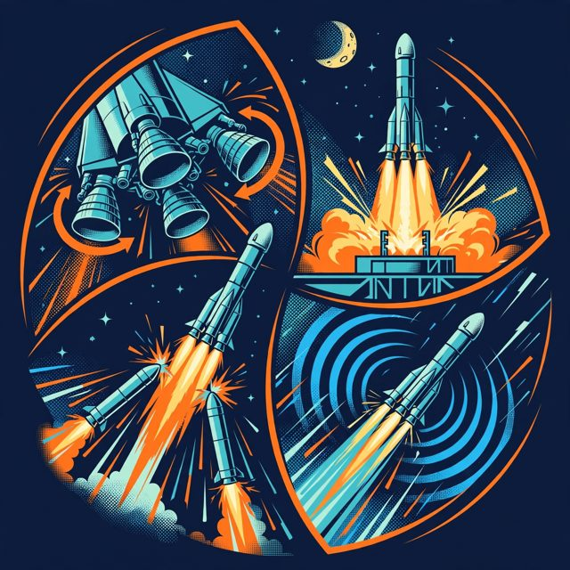

# Example run — real outputs, unedited

Everything in this folder was produced by **one clean end-to-end run on Oct 31, 2026** (fresh data, two real Telegram subscribers, two NASA videos dropped into watched source folders). Nothing here was written by hand. Subscribers are anonymised as Subscriber 1 and Subscriber 2 (Telegram chat IDs and names removed); video footage is not included (see Credits in the main README).

## What happened, in one table

| Video | Subscriber 1 (space tech: engines, separations; ~2 min) | Subscriber 2 (current affairs: big news only; under 1 min; no politics) |
|---|---|---|
| **Artemis I launch** — 60 min, NASA | 🎯 **5 clips, 114 s**: gimbal test → ignition & liftoff → Max Q → booster separation → fairing separation | 🎯 **4 clips, 60 s**: go for launch → liftoff → boosters separate → solar arrays deployed |
| **Artemis news briefing** — 28.6 min, NASA News | ⏭ **Skipped**: *"all briefing talk with no engine ignition, liftoff, or separation footage"* | 🎯 **4 clips, 60 s**: Artemis III in 2027, Moon landing in 2028, LEO docking test, Mobile Launcher dropped — the two *politics/budget* moments were left out |

Same video → two different reels. Different video → one person served, one skipped with a reason.

## Files

| File | What it is | Made by |
|---|---|---|
| [`launch/timeline.json`](launch/timeline.json) | 600 segment notes → **16 moments**, `kind: event`, anchored on liftoff (T−/T+ times) | Muse Spark 1.3, one long-context call |
| [`briefing/timeline.json`](briefing/timeline.json) | 287 segment notes → **18 moments**, `kind: talk`, split by topic (announcement / explainer / politics/budget …), no anchor | Muse Spark 1.3 |
| [`launch/reel_subscriber1.json`](launch/reel_subscriber1.json), [`launch/reel_subscriber2.json`](launch/reel_subscriber2.json), [`briefing/reel_subscriber2.json`](briefing/reel_subscriber2.json) | Each person's reel: profile in their own words, chosen clips with reasons and priorities, dropped candidates, self-check verdicts, recap | Muse Spark 1.3 (selection, recap) + Muse Spark 1.2 (self-check) |
| `*/cover_*.jpg` | Cover art sent with each reel (downscaled) | Muse Image |
| [`decision_log.jsonl`](decision_log.jsonl) | Every agent decision as logged for the Control Room live feed | `common/events.py` |

## Covers

| Subscriber 1 · launch | Subscriber 2 · launch | Subscriber 2 · briefing |
|---|---|---|
|  |  |  |

## The live feed, as it happened (IST)

Watch-progress ticks omitted. Watching is the slow step: 600 Muse Spark calls took 14 min with 8 workers.

| Time | Event |
|---|---|
| 10:46:10 | 👋 **Subscriber 1** onboarded — interests: space technology, rocket launches |
| 10:46:48 | 👋 **Subscriber 2** onboarded — interests: current affairs, major announcements, decisions, new dates, milestones, launches |
| 10:47:28 | 🆕 New video on **NASA** (space): `artemis_launch.mp4` |
| 10:50:17 | ✂️ Split into 600 six-second segments (60.0 min) |
| 11:04:19 | 👀 Muse Spark 1.2 watched all 600 segments (video + audio) |
| 11:04:44 | 🧭 16 moments found in “Artemis I Night Launch - SLS and Orion to the Moon” |
| 11:04:45 | 📡 Checking 2 subscribers for “Artemis I Night Launch - SLS and Orion to the Moon” |
| 11:04:47 | 🎯 **Subscriber 1** matched — Matches interest in rocket launches with live engine ignition, liftoff, and booster separations. |
| 11:06:42 | ✓ Self-check (pass) “RS-25 gimbal steering test” for Subscriber 1 — Live close-up of four RS-25 engines gimballing on the SLS core stage during terminal count |
| 11:06:42 | ✓ Self-check (pass) “Engine ignition and liftoff” for Subscriber 1 — Live nighttime footage of SLS RS-25 engine and booster ignition with hydrogen burnoff, followed by liftoff and ascent |
| 11:06:42 | ✓ Self-check (pass) “Engines throttle through Max Q” for Subscriber 1 — A rocket ascends at night with a bright engine plume while flight commentary describes four core engines throttling down for Max Q and back to maximum thrust |
| 11:06:42 | ✓ Self-check (pass) “Solid rocket booster separation” for Subscriber 1 — Live nighttime footage of twin solid rocket boosters separating from the core stage with two bright plumes moving apart |
| 11:06:42 | ✓ Self-check (pass) “Service module fairing separation” for Subscriber 1 — Onboard VIS-FOV live camera shows service module fairing panels separating with telemetry overlay and voice confirmation about 3 minutes into flight |
| 11:06:42 | 🎨 muse-image-1.0 painted cover art for Subscriber 1 |
| 11:06:53 | 📨 Delivered to **Subscriber 1**: 5 clips, 114s — “You get RS-25 ignition through liftoff, throttling through Max Q, booster jettison and fairing separation plus the gimbal steering test. All clips use live pad and tracking views showing thrust, speed and staging as it happened.” |
| 11:06:56 | 🎯 **Subscriber 2** matched — Artemis I liftoff is a major launch milestone matching interest in launches and big news. |
| 11:08:41 | ✓ Self-check (pass) “Go to launch Artemis One” for Subscriber 2 — Launch director in control room gives go to resume count for Artemis One launch |
| 11:08:41 | ✓ Self-check (pass) “Artemis One lifts off” for Subscriber 2 — Live night launch of Artemis I SLS with engine hydrogen burn-off, ignition and liftoff ascending on bright plume |
| 11:08:41 | ✓ Self-check (pass) “Boosters separate in flight” for Subscriber 2 — Night live footage shows two solid rocket boosters separating and trailing fire as the core stage continues flight |
| 11:08:41 | ✓ Self-check (pass) “All solar arrays deployed” for Subscriber 2 — Audio confirms all four solar arrays deployed over overexposed live spacecraft view and Mission Control Center |
| 11:08:41 | 🎨 muse-image-1.0 painted cover art for Subscriber 2 |
| 11:08:50 | 📨 Delivered to **Subscriber 2**: 4 clips, 60s — “You got the go for launch, the liftoff of Artemis One, booster separation in flight, and confirmation all four solar arrays deployed. These are the major decisions and milestones from the broadcast.” |
| 11:08:51 | ✅ Finished serving NASA: artemis_launch |
| 11:10:31 | 🆕 New video on **NASA NEWS** (current affairs): `artemis_briefing.mp4` |
| 11:11:50 | ✂️ Split into 287 six-second segments (28.6 min) |
| 11:18:44 | 👀 Muse Spark 1.2 watched all 287 segments (video + audio) |
| 11:19:30 | 🧭 18 moments found in “NASA lays out accelerated Moon return: Artemis III in 2027, landing in 2028” |
| 11:19:30 | 📡 Checking 2 subscribers for “NASA lays out accelerated Moon return: Artemis III in 2027, landing in 2028” |
| 11:19:33 | ⏭ **Subscriber 1** skipped — Broadcast is all briefing talk with no engine ignition, liftoff, or separation footage they want. |
| 11:19:36 | 🎯 **Subscriber 2** matched — Matches interest in major announcements and new dates with Artemis III in 2027 and Moon landing in 2028. |
| 11:21:17 | ✓ Self-check (pass) “Artemis 3 to carry four astronauts” for Subscriber 2 — SLS core stage in hangar while narration announces Artemis 3 will launch next year with four astronauts to low Earth orbit to practice docking |
| 11:21:17 | ✓ Self-check (pass) “Artemis 3 launch set summer 2027” for Subscriber 2 — A man in a suit announces at a podium that Artemis 3 is set for a summer 2027 launch after a year-end tanking test |
| 11:21:17 | ✓ Self-check (pass) “Astronauts to return to Moon 2028” for Subscriber 2 — A NASA official at a podium announces American astronauts will take first steps on the lunar surface in 2028 |
| 11:21:17 | ✓ Self-check (pass) “Mobile Launcher and upper stage dropped” for Subscriber 2 — Official in suit at press conference announces decision to drop Mobile Launcher and Exploration Upper Stage to focus on rate and reliability |
| 11:21:17 | 🎨 muse-image-1.0 painted cover art for Subscriber 2 |
| 11:21:28 | 📨 Delivered to **Subscriber 2**: 4 clips, 60s — “You get the two big dates, summer 2027 for Artemis 3 and 2028 for the Moon return, plus the four-astronaut LEO test and the decision to drop the Mobile Launcher combo.” |
| 11:21:28 | ✅ Finished serving NASA NEWS: artemis_briefing |
| 11:23:11 | 🎙 Subscriber 2 voice note (3.3s) → “show me where they were talking about 2028 moon landing.” |
| 11:23:49 | 💬 Subscriber 2 asked “show me where they were talking about 2028 moon landing.” → **clip**: Yes, they laid out Artemis 4 keeping both landers ready so astronauts can land on the Moon in 2028. Here it is: |
| 11:26:02 | 🎙 Subscriber 2 voice note (3.9s) → “What are the other private agencies involved in this uh project?” |
| 11:26:09 | 💬 Subscriber 2 asked “What are the other private agencies involved in this uh project?” → **answer**: The briefing only names Blue Origin — with its New Glenn rocket and Mark One landers — and otherwise talks about two commercial test landers / landing systems for Artemis 4 and industry partners generally. It doesn't name the other company. |
| 11:26:42 | 🎙 Subscriber 2 voice note (4.6s) → “can you show me where they were talking about the other private agencies involved?” |
| 11:26:49 | 💬 Subscriber 2 asked “can you show me where they were talking about the other private agencies involved?” → **clip**: Yes, they highlighted Blue Origin's New Glenn rocket and Mark One landers as moon base precursors sharing hardware with the crewed landers, plus two commercial test landers for Artemis 3 docking practice. Here it is: |

The last exchange is a fair example of the agent staying grounded: asked to name "other private agencies", it says the briefing only names Blue Origin rather than guessing.
